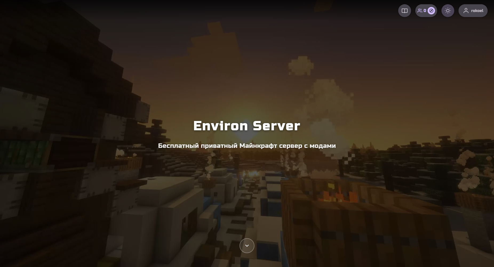

# Environ Server - Minecraft Server Website

## Project Overview

Flask-based website for a modded Minecraft server with Telegram OAuth authentication. Features Material You design, dynamic forms, admin panel, and file uploads.



## Quick Start

### 1. Install Dependencies
```bash
cd environ-server
pip install -r requirements.txt
```

### 2. Configure Environment Variables
Create a `.env` file or set environment variables:
```bash
export TELEGRAM_BOT_TOKEN="your_bot_token_here"
export SECRET_KEY="your_secret_key_here"
```

### 3. Add Video File
Place your webm video file at: `static/video/background.webm`
And a fallback image at: `static/video/fallback.jpg`

### 4. Run the Application
```bash
python app.py
```

The local server runs on port 5000 with debug mode disabled. For local development,
set `DEBUG=true` explicitly to enable it.

### 5. Access the Website
Open http://localhost:5000 in your browser

---

## VPS Deployment Instructions

### Using Gunicorn + Nginx (Recommended)

#### 1. Install Dependencies on VPS
```bash
pip install -r requirements.txt
pip install gunicorn
```

#### 2. Create Systemd Service
Create `/etc/systemd/system/environ-server.service`:
```ini
[Unit]
Description=Environ Server
After=network.target

[Service]
User=www-data
Group=www-data
WorkingDirectory=/path/to/environ-server
Environment="PATH=/path/to/venv/bin"
Environment="TELEGRAM_BOT_TOKEN=your_bot_token"
Environment="SECRET_KEY=your_secret_key"
ExecStart=/path/to/venv/bin/gunicorn --workers 3 --bind 127.0.0.1:5000 app:app

[Install]
WantedBy=multi-user.target
```

#### 3. Configure Nginx
Create `/etc/nginx/sites-available/environ-server`:
```nginx
server {
    listen 80;
    server_name your-domain.com;

    location / {
        proxy_pass http://127.0.0.1:5000;
        proxy_set_header Host $host;
        proxy_set_header X-Real-IP $remote_addr;
        proxy_set_header X-Forwarded-For $proxy_add_x_forwarded_for;
    }

    location /static {
        alias /path/to/environ-server/static;
    }

    location /uploads {
        alias /path/to/environ-server/uploads;
    }
}
```

#### 4. Enable and Start
```bash
sudo ln -s /etc/nginx/sites-available/environ-server /etc/nginx/sites-enabled
sudo systemctl daemon-reload
sudo systemctl start environ-server
sudo systemctl enable environ-server
sudo nginx -t && sudo systemctl reload nginx
```

---

## Features

### Landing Page
- Full-screen video background with dark overlay
- Server name and tagline
- 5 alternating info blocks with scroll animations
- Social links (Telegram, Email, VK)
- Theme toggle (light/dark)

### Authentication
- Telegram OAuth via Login Widget
- Session-based authentication
- Admin access via `admins.json`

### User Dashboard
- Application form (dynamic, markdown-based)
- Status display (unverified/pending/verified/rejected/banned)
- Rejection reason display
- Server info for verified users (IP, instructions, downloads)
- File upload support

### Admin Panel
- View all applications
- Filter by status
- Sort by date/username/status
- Verify/Reject/Ban users
- Markdown form editor

### Security
- CSRF protection (Flask-WTF)
- Input sanitization (Bleach)
- Secure file uploads (extension whitelist, 30MB limit)
- Telegram hash verification

---

## Configuration Files

### admins.json
The repository ships with an empty admin list. Add your own Telegram IDs locally
to grant admin access; do not commit real IDs:
```json
{
  "admin_ids": ["123456789", "other_id"]
}
```

### form.md
Define your application form using markdown:
```markdown
## Question Title
- type: text|textarea|dropdown|multiselect|file
- required: true|false
- options: option1, option2, option3 (for dropdown/multiselect)
```

### Server Info (in dashboard.html)
Edit the `server-info-card` section to customize:
- Server IP and port
- Connection instructions
- Download buttons (use `data-filename` attribute)
- Discord link

---

## Download Button Usage

To add download buttons for verified users, add this to dashboard.html:
```html
<a href="#" class="download-button" data-filename="modpack.zip">
    <svg>...</svg>
    <span>Скачать модпак</span>
</a>
```

The `data-filename` attribute specifies which file to download from `/uploads/{telegram_id}/`.

---

## Project Structure
```
environ-server/
├── app.py              # Main Flask application
├── config.py           # Configuration
├── models.py           # Database models
├── admins.json         # Admin IDs
├── form.md            # Form definition
├── requirements.txt    # Dependencies
├── static/
│   ├── css/style.css  # Material You styles
│   ├── js/main.js     # Frontend JavaScript
│   └── video/         # Background video
├── templates/         # HTML templates
└── uploads/           # User uploads (auto-created)
```
